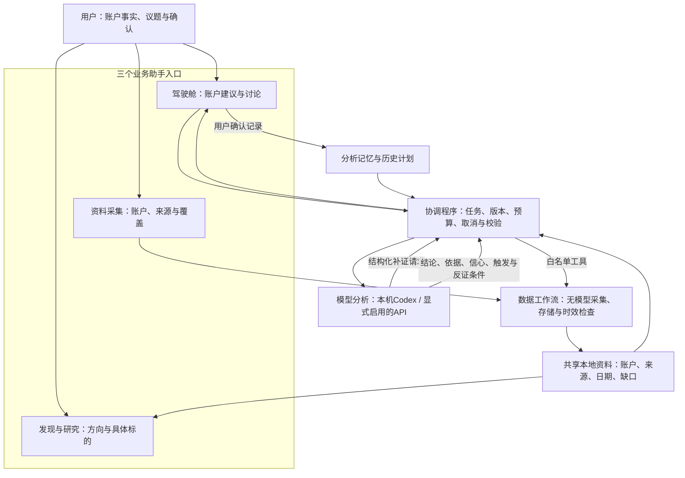

# Stock-Pilot

本地化 A 股投资辅助工作台，当前版本 **v4.5.0**。

围绕“资料采集 → 投资讨论与建议 → 确认记录 → 后续复核”组织工作：程序负责客观取数与记录，模型解释证据并提出条件性计划，用户保留决策与交易权。
不自动下单，不保证收益，不把数据缺失当作利空，也不把模型意见当作已核验事实。

## 产品结构

### 三个业务助手

| 入口 | 职责 | 主要输入与输出 | 协作方式 |
| --- | --- | --- | --- |
| **驾驶舱助手** | 账户判断与投资讨论 | 账户、证据和记忆 → 账户建议、行业方向、标的计划、信心与行动条件 | 使用采集资料；确认的判断进入历史记忆，供后续分析复核 |
| **资料采集助手** | 事实维护、更新与质量检查 | 持仓/关注池、现金、交易、行情日K、财报、重要参考 → 有来源和日期的资料、缺口及覆盖状态 | 提供版本化证据，执行受限补证；启动及定时更新不依赖模型 |
| **发现与研究助手** | 方向筛选与标的研究 | 行业代理、轮动阶段、公开量价事实 → 候选方向、代表ETF/龙头与个股研究依据 | 共享持仓、关注池和来源缓存；研究议题可在驾驶舱统一入口继续分析 |

这是面向业务的助手分工，**不是三个页面各自常驻一个独立大模型**。
当前执行层由确定性数据工作流、模型分析侧和协调程序组成；发现与研究复用这些能力及既有研究模块，不是已经实现了独立的第三个自主推理进程。

### 多角色协作架构



助手通过**共享资料、结构化请求和版本校验**协作，不是让模型互相自由对话：

1. 数据侧读取正式账户与关注池，按来源缓存策略取数，分别保存观测日期、抓取时间、单位及失败信息。
2. 协调程序保存任务、上下文版本和账户指纹，将必要证据、历史判断交给分析侧。
3. 分析侧可请求 `market / disclosure / events` 补证；限已有持仓与关注标的，受工具白名单和次数约束。
4. 数据侧返回新证据或明确失败，形成新版上下文；模型继续分析，预算最后一轮须形成有限结论。
5. 结果经过Schema、引用、账户指纹与业务校验，先预览，**用户确认后**才记录为分析记忆。
6. 后续任务读入历史计划、条件与教训，以及最近已确认交易记录；快照变化不冒充真实成交。

原始资料及完整PDF保存在本地，模型只接收受预算约束的必要选段。
当前有记忆输入和计划复核基础，但不宣称已完成完整收益归因、策略回测或自动验证模型投资能力。

### 模型接入

- **主流程**：网页发起 → 数据侧真实取数 → 本机已登录的Codex CLI分析/请求补证 → 网页预览确认。复用正式CLI登录及账号额度，不提取或代理令牌，不要求填写OpenAI API Key。
- **保留流程**：生成本地材料 → 在外部模型中自然讨论 → 结束后回传结构化JSON → 预览确认。与程序化任务隔离，不覆盖正在进行的手动讨论。
- **可选模型API**：使用后端配置，默认禁用；配置存在不代表权限有效，须显式启用并主动选择。

本机Codex采用只读沙箱，关闭命令执行、文件修改、子Agent等非必要工具。模型不能直接写持仓或执行交易。
运行失败、截断、未知引用或账户过期均显式处理，不回填样本结论。

## 状态机制

### 页签状态灯

每个业务页签旁有绿、黄、红状态灯，悬停或键盘聚焦可查看原因。
**工作状态、数据覆盖、模型结论信心是不同概念**；状态灯不是投资风险评级或收益概率。

| 状态 | 含义 | 示例 |
| --- | --- | --- |
| 绿色 | 主要工作条件就绪 | 资料采集狭义覆盖无重大缺失；个别补充来源缺口仍保留 |
| 黄色 | 运行中、待更新或条件不完整 | 重要参考过期、持仓行情缺失、已有分析对应旧账户 |
| 红色 | 关键能力不可用或最近分析失败 | 无可用模型入口、关键行情整体不可用、任务执行失败 |

资料采集灯检查数据工作条件；驾驶舱、发现研究还检查各自依赖的来源、模型入口与分析时效。
检测到Codex仅证明入口存在，登录、模型权限和额度仍需在真实运行时确认。
读取状态不会触发模型或采集；打开、刷新页面也不会自动发起模型分析。

### 狭义与广义广度

这里的“狭义广度”是**重点资料的时效覆盖**，不是市场上涨/下跌家数。

| 类型 | 范围与判定 | 对健康灯的影响 |
| --- | --- | --- |
| **狭义广度** | 持仓、重点关注标的，以及境内大盘、纳指、美元、黄金、有色参考组 | 决定资料采集是否健康：已上市持仓日K均有效，关注池覆盖至少80%，各参考组有有效来源；盘中另检查报价时效 |
| **广义广度** | 本地全市场日K覆盖、成交额和涨跌家数统计 | 单独展示日期、数量和比例；全市场未补齐不拖低狭义健康灯，低覆盖样本不能冒充两市全量 |

默认参考包括沪指、沪深300、纳斯达克综合指数、美元指数，以及黄金和有色ETF/期货参考。
ETF、期货明确标为代理，不冒充同名现货指数；海外按源交易时段和观测时效检查，不用A股日期强求美股当日收盘。
无明确海外时段时采用保守的48/96小时观测窗口，不声称已认证完整海外节假日日历。

### 进度、确认与记忆

- 显示真实阶段、已用时、心跳、来源返回数量、补证次数、模型调用及已返回的Token，不编造完成百分比。
- 单任务默认最多3次模型调用，可配置1至4次；受限补证最多4项。支持取消，但不能撤回已发送的资料或已消耗的额度。
- 账户在采集、推理或确认前发生变化，会阻止旧结果直接记录；待确认结果须确认或放弃，不静默覆盖。
- 确认后的分析进入后续任务记忆；事实、模型观点、限制与历史判断分开保留。

## 自动数据维护

客观数据维护不需要网页、模型API或Codex持续打开：

- **程序启动**：正式后端默认启动独立无模型采集，先更新重点日K、行情与参考，再处理其他来源和全市场续传。
- **定时维护**：安装Windows任务后，当前用户登录及每30分钟触发，按来源TTL跳过重复下载，不唤醒关机或休眠的电脑。
- **全市场补齐**：按本地股票/ETF元数据分批更新，每轮最多200个标的、单阶段最长300秒，保存已核验日期及续传游标。
- **运行边界**：每轮总预算20分钟，未完成部分下一轮继续，不承诺一次启动补完全部历史数据。
  分析侧不主动执行全市场续传；后台续传占锁但重点资料已验证就绪时，可复用有效资料继续分析。

```powershell
python backend/scripts/sync_data.py
python backend/scripts/sync_data.py --status
python backend/scripts/sync_data.py --stages market references --force
.\scripts\manage_data_sync.ps1 -Action Install -PythonPath (Get-Command python).Source
```

取数不改变持仓，不解析截图，不自动确认结果或交易。设置后端进程环境变量 `STOCK_PILOT_AUTO_DATA_SYNC=0` 可关闭启动采集。
旧模型自动巡检默认关闭，不必为恢复数据更新而打开旧的混合自动化总开关。
详见 [无网页数据维护](docs/headless-data-sync.md)。

## 账户与研究能力

- 手动维护账户、现金和关注池；持仓截图与交易截图分别导入，识别后形成待确认草稿。
- 完整账户JSON可在交叉校验后自动记账，保留差异、来源与前镜像；撤销不得覆盖后续人工修改。
- 支持同花顺式摊薄负成本；快照变化不自动冒充逐笔成交。
- 新股可作为 `ipo_subscription` 纳入；未上市无日K会单列说明，不直接视为行情故障。
- 轮动分为“潜在机会、早期转强、强势但等回踩、暂不参与”，公开ETF/龙头代理，支持方向深挖和个股研究。
- 单票/组合Packet、本地讨论交接、技术指标、事件与主题证据等已有能力保留。
- 健康度、吸引力等旧规则分数仅作辅助参考，不当作行业标准或模型信心，收于明细而非主导首页。
- 旧视觉和部分独立分析入口仍依赖各自供应商，并非全部迁移至Codex或重新验证。

## 界面演示

以下为**历史版本脱敏录屏**，不代表v4.5的三个助手及最新状态机制；当前结构以本文和正式工作台为准。


[v4.4合成账户架构演示](docs/dual-agent-demo.md) 仅保留为机制测试材料，不是正式主入口或真实模型效果证明。

## 项目结构

```text
Stock-Pilot/
  backend/
    app/
      investment_agents/    真实任务、模型适配、证据交接、状态、审计与记忆
      data_sync/            无模型采集、启动任务、参考数据、超时与全市场续传
      market_breadth/       本地全市场广度统计
      portfolio/            正式账户、截图草稿、交易台账、快照与锁
      collector/            行情与历史K线读取
      disclosure_verification/ 公告索引及正文取证
      analysis_packet/      单票/组合资料包与账户上下文
      rotation/             行业代理池、轮动阶段与方向研究
      agent_review/         外部讨论、计划、复盘及旧流程兼容
      api/                  API路由
    data/                   私有账户、缓存、证据、任务（运行数据不提交Git）
    scripts/sync_data.py    独立无模型采集CLI
    tests/                 数据、协议、状态与安全测试
  frontend/src/
    components/            三个业务助手、计划、来源覆盖及明细
    composables/           共享工作状态与账户概览显示开关
    api/                   API客户端及端口配置
  scripts/                 启动、Windows定时任务与浏览器验收
  docs/                    实现说明、协议、历史设计与脱敏素材
```

## 技术栈

| 层级 | 技术 |
| --- | --- |
| 前端 | Vue 3、Vite、TypeScript、Tailwind CSS、Lucide、lightweight-charts |
| 后端 | FastAPI、Pydantic、pandas、pyarrow |
| 数据 | 本地Parquet/JSON、BaoStock、腾讯报价、巨潮公告、Yahoo延迟参考、官方RSS；部分来源可选Tushare |
| 模型 | 本机Codex CLI及结构化输出；可选OpenAI-compatible API；旧视觉入口单独配置 |
| 工程 | pytest、Playwright、Git、原子写入、进程锁、Windows无模型任务 |

## 快速开始

安装Python、Node.js及依赖；模型分析另需可用的Codex CLI登录，或显式启用模型API。

```powershell
python -m pip install -r backend/requirements.txt
if (-not (Test-Path backend/.env)) { Copy-Item backend/.env.example backend/.env }
npm --prefix frontend install
.\scripts\start_app.ps1
```

- 默认前端 `http://127.0.0.1:5173/`；后端检查 `http://127.0.0.1:8000/health`。
- 重启用 `.\scripts\start_app.ps1 -Restart`；端口冲突时以脚本输出为准，前端也可手动修改API地址。
- 本机分析：填写议题 → 同意资料发送 → 更新资料并分析 → 查看依据与条件 → 确认记录。
- 来源失败、未接入账户或模型不可用均显示缺口，不生成假行情或样本建议。

手动启动：

```bash
cd backend
uvicorn app.main:app --host 127.0.0.1 --port 8000
# 另一终端：
cd frontend
npm run dev
```

保留Docker Compose配置，但容器不会自动取得宿主机Codex登录和Windows任务；启动容器不等于本机分析链路已接通。

## 配置与隐私

- 后端 `.env` 可配置 `LLM_BASE_URL / LLM_API_KEY / LLM_MODEL`；真实密钥、账户资料、截图和运行日志不得提交Git。
- 启动采集开关是后端进程环境变量；`STOCK_PILOT_ENABLE_LEGACY_AUTOMATION=1`为旧混合自动化显式开关，默认关闭。
- 模型只在用户同意并主动发起后接收必要账户上下文；模型端处理与额度仍受所选服务约束。
- 账户入账和分析确认是不同操作；确认计划不改真实持仓或生成订单。
- 眼睛按钮**仅遮蔽顶部四项账户概览**，不隐藏下方讨论或其他账户页面，不是完整脱敏或访问控制。
- 真实账户与模型接口限制本机访问；这是个人工具，不是可直接开放公网的多租户服务。
- 公开演示使用脱敏素材；不公开真实模型输入输出、本地讨论目录或真实账户验收截图。

## 关键接口

| API | 用途 |
| --- | --- |
| `GET /api/investment-agents/assistant-status` | 助手状态、两类覆盖和启动/续传状态；只读 |
| `GET /api/investment-agents` | 当前分析任务、配置入口与待确认结果 |
| `POST /api/investment-agents/runs` | 同意后建立真实分析任务 |
| `POST /api/investment-agents/runs/{id}/cancel` | 停止或放弃结果 |
| `POST /api/investment-agents/runs/{id}/confirm` | 校验摘要和账户版本后记录分析记忆 |
| `GET /api/investment-agents/runs/{id}/evidence/{ref}` | 核对原始证据 |
| `POST /api/investment-agents/account-import` | 完整账户JSON校验入账及审计 |
| `GET /api/system/data-sync-status` | 独立采集状态 |
| `GET /api/portfolio` / `PUT /api/portfolio` | 读取/保存正式账户 |
| `POST /api/portfolio/import/screenshot` | 截图生成待确认草稿 |
| `GET /api/rotation/summary` | 方向阶段与代理标的 |
| `POST /api/analysis-packet/portfolio` | 组合资料包 |

运行后在本机 `/docs` 查看完整接口；历史接口文档可能含兼容路径，调用前核对当前服务。

## 验证与文档

```powershell
Set-Location backend
python -m pytest tests/test_investment_agents.py tests/test_headless_data_sync.py tests/test_narrow_coverage_and_startup.py tests/test_daily_k_refresh_and_breadth.py tests/test_external_discussion.py tests/test_task_runtime.py tests/test_agent_collaboration_demo.py -q
Set-Location ../frontend
npm run build
Set-Location ..
node scripts/smoke_investment_agents.cjs
```

单元测试使用临时账户及mock模型，浏览器脚本默认mock接口，不消耗模型额度。
浏览器验收需要可用的Playwright和Edge。真实取数、模型权限及投资分析质量是不同验收项，不由构建成功或单次分析证明。

- [真实投资协作流程、模型边界与确认机制](docs/investment-agents.md)
- [无网页采集、参考指标及全市场续传](docs/headless-data-sync.md)
- [外部手动讨论与本地文件交接](docs/external-discussion.md)
- [投资计划与记忆工作流](docs/investment-plan-workflow.md)
- [账户级AI上下文](docs/account_ai_context_design.md)
- [脱敏试运行](docs/sanitized_trial_run_guide.md)

## License

MIT
