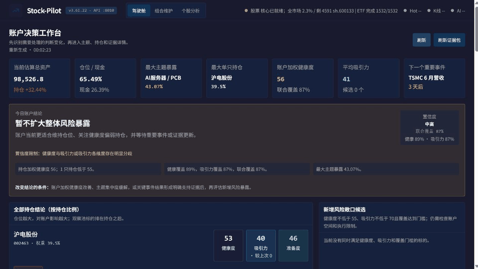

# Stock-Pilot

本地化 A 股账户驾驶舱与 AI 分析上下文工具。Stock-Pilot 不是自动交易系统，也不直接给出买卖指令；它把行情、持仓、成本、主题、事件、证据和数据缺口整理成可审计的账户上下文，帮助用户在本地完成投资复盘、风险检查和外部 AI 分析准备。

## Demo

> 下方动图使用脱敏演示组合录制，不包含真实账户数据。



## 当前重点能力

- **账户驾驶舱**：展示当前估算总资产、仓位/现金、最大主题暴露、最大单票、账户加权健康度、平均吸引力和下一个重要事件。
- **组合级结论**：按持仓权重输出账户结论、持仓健康度、吸引力、准备度、风险队列、机会队列和改变结论的条件。
- **事件雷达**：跟踪 CPI、非农、FOMC、TSMC、Micron 等宏观和产业事件，提示事件窗口、影响方向和相关持仓。
- **主题证据雷达**：围绕 AI 服务器/PCB、有色金属、半导体设备、显示面板、绿电等方向组织证据、风险和覆盖度。
- **吸引力雷达**：基于趋势、估值/价格位置、催化剂、执行约束、账户约束等维度，形成可解释的新增风险敞口观察分。
- **组合维护**：手动维护账户快照、现金、成本、持仓角色、方向标签、风险标签和用户计划，保存后进入 Portfolio Packet。
- **新股/未上市标的纳入**：支持将已申购但未上市的新股作为 `ipo_subscription` 纳入组合上下文，使用发行价/手动成本进行本地估值，并在数据边界中标注行情缺口。
- **单票与组合 Packet**：生成单票分析包、组合分析包和 AccountAnalysisContext，便于复制给外部 LLM 进行进一步分析。
- **隐私边界**：账户数据默认本地处理；只有用户主动复制、导出或提交时，才进入外部分析流程。

## 项目结构

```text
Stock-Pilot/
├─ backend/                 FastAPI 后端
│  ├─ app/
│  │  ├─ api/               API 路由
│  │  ├─ ai/                LLM 请求与提示词构建
│  │  ├─ analysis/          技术指标与基础分析
│  │  ├─ analysis_packet/   单票/组合 Packet 与账户上下文
│  │  ├─ attractiveness/    吸引力雷达
│  │  ├─ collector/         行情与历史数据采集
│  │  ├─ portfolio/         组合快照、驾驶舱、导入、IPO 注册表
│  │  ├─ quant/             量化信号与趋势证据
│  │  └─ theme_evidence/    主题证据雷达
│  ├─ data/                 本地数据、缓存和组合快照
│  └─ requirements.txt
├─ frontend/                Vue 3 + Vite 前端
│  └─ src/
│     ├─ api/               API client
│     └─ components/        驾驶舱、组合维护、K 线、Packet 面板
├─ docs/                    设计文档、验收样例、发布检查
├─ scripts/                 本地启动脚本
└─ docker-compose.yml
```

## 技术栈

| 层级 | 技术 |
| --- | --- |
| 前端 | Vue 3, Vite, TypeScript, Tailwind CSS, lightweight-charts |
| 后端 | FastAPI, Pydantic, pandas, pyarrow |
| 数据 | 本地 parquet, portfolio JSON, Tushare/akshare/easyquotation 缓存 |
| AI | OpenAI-compatible LLM API, Prompt Builder, AccountAnalysisContext |
| 工程 | Docker Compose, pytest, GitHub README demo assets |

## 快速开始

### 方式一：本地脚本启动

Windows 环境可直接使用项目脚本同时启动前后端：

```powershell
powershell -ExecutionPolicy Bypass -File scripts/start_app.ps1 -Restart
```

默认地址：

- 前端：`http://127.0.0.1:5173`
- 后端健康检查：`http://127.0.0.1:8000/health`

如果端口被占用，脚本会自动寻找后续可用端口，并把前端 API 地址指向对应后端。

### 方式二：手动启动

后端：

```bash
cd backend
python -m venv venv
source venv/bin/activate  # Windows: venv\Scripts\activate
pip install -r requirements.txt
cp .env.example .env
uvicorn app.main:app --reload --host 127.0.0.1 --port 8000
```

前端：

```bash
cd frontend
npm install
npm run dev
```

如需指定后端地址：

```bash
VITE_API_BASE_URL=http://127.0.0.1:8000 npm run dev
```

### 方式三：Docker Compose

```bash
docker-compose up --build
```

## 环境变量

后端配置文件位于 `backend/.env`，可从 `backend/.env.example` 复制。

常用配置：

| 变量 | 说明 |
| --- | --- |
| `LLM_BASE_URL` | OpenAI-compatible API 地址 |
| `LLM_API_KEY` | LLM API Key，不要提交到 Git |
| `LLM_MODEL` | 默认模型名 |
| `TUSHARE_TOKEN` | Tushare token，仅后端使用 |
| `PORTFOLIO_DATA_DIR` | 本地组合快照目录，默认 `data/portfolio` |
| `ANALYSIS_SNAPSHOT_DIR` | 分析快照与 Packet 输出目录 |
| `DASHBOARD_CACHE_SECONDS` | 驾驶舱缓存时间 |
| `CORS_ORIGINS` | 允许访问后端的前端地址 |

## 关键 API

| API | 用途 |
| --- | --- |
| `GET /health` | 后端健康检查 |
| `POST /api/analyze` | 单票快速分析 |
| `GET /api/portfolio` | 读取本地组合状态 |
| `PUT /api/portfolio` | 保存组合快照 |
| `GET /api/portfolio/dashboard` | 账户驾驶舱数据 |
| `GET /api/portfolio/account-analysis-context` | 账户级 AI 上下文 |
| `POST /api/analysis-packet/single/{symbol}` | 生成单票 Packet |
| `POST /api/analysis-packet/portfolio` | 生成组合 Packet |
| `GET /api/stocks/search` | 股票/ETF/新股搜索 |
| `GET /api/stocks/{symbol}/quote` | 单标的行情与元数据 |

## 数据与隐私边界

- `backend/.env`、真实账户快照、分析导出、截图、上传文件和缓存目录不应提交到 Git。
- README 动图和验收样例应使用脱敏或合成数据。
- Portfolio Packet 可能包含真实持仓、成本、现金、用户计划和手工证据；默认只在本地生成。
- 系统不会自动把账户上下文发送给外部 LLM；外部分析必须由用户主动复制、导出或提交。
- 本项目输出仅用于事实整理、风险提示和复盘辅助，不构成买入、卖出、加仓、减仓或择时指令。

## 测试

后端测试：

```bash
cd backend
pytest
```

前端构建检查：

```bash
cd frontend
npm run build
```

## 文档

- [API 文档](docs/API.md)
- [账户级 AI 上下文设计](docs/account_ai_context_design.md)
- [脱敏试运行指南](docs/sanitized_trial_run_guide.md)
- [Phase 3.6E 验收检查](docs/phase3_6e_acceptance_checklist.md)

## License

MIT
