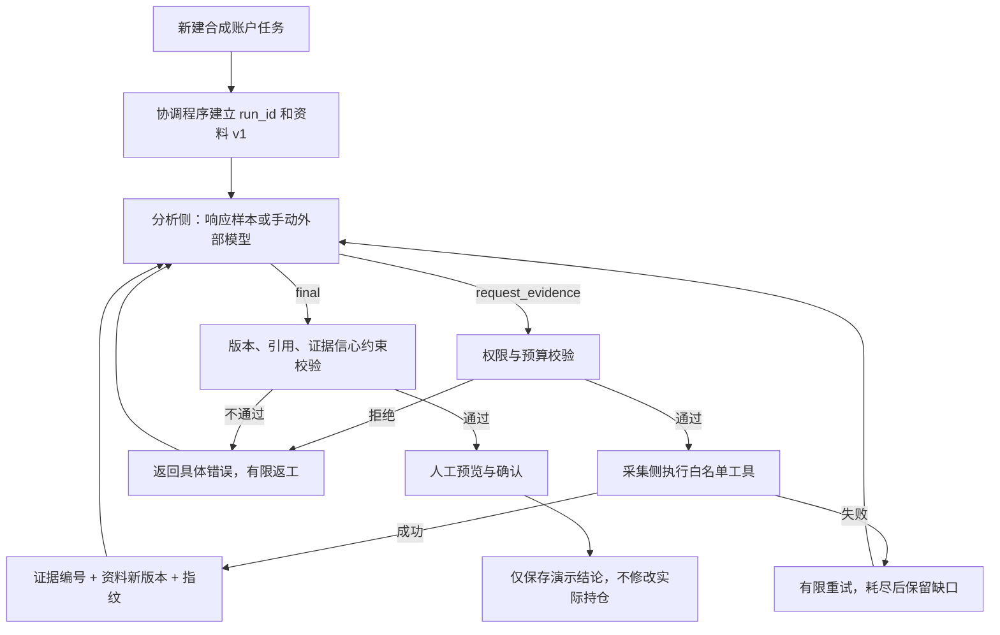

# 双 Agent 协作演示 · v4.4

## 目的与边界

这是独立的、可重复操作的架构演示，不是把原投资平台切换成未经验证的自主交易系统。
它用于展示两个角色如何交换任务和证据，以及协调程序如何处理版本、权限、失败和人工确认。

- **分析侧**：默认使用明确标注的场景响应样本，根据已经返回的证据、错误和版本选择下一次请求或结论。没有调用模型，也不声称样本来自历史真实模型运行。
- **采集侧**：执行白名单工具；默认读取合成素材并真实计算市值、账户权重。勾选联网后，行情工具实际请求固定公开行情地址；财报和事件仍是合成素材。
- **协调程序**：确定性状态机，不是第三个 Agent。负责持久化、版本校验、预算、重试、引用验收和确认。
- **手动模式**：复制带完整上下文的提示词给任意外部模型，回传 JSON 后由相同协调程序执行取证和验收。外部模型如何使用、是否收费由使用者自行决定，平台不调用其 API。

这里的 Agent 是角色和交接协议原型。默认分析侧不是实时智能体，采集侧是受限工具执行器；演示不能证明模型推理质量、自主协作能力、投资准确率或收益。内部协议未声明 A2A 兼容。

## 独立运行

在项目根目录构建页面：

```powershell
Set-Location C:\Project\Stock-Pilot\frontend
npm ci
npm run build
```

另一个终端启动独立服务，使用项目已配置的 Python 环境：

```powershell
Set-Location C:\Project\Stock-Pilot\backend
C:\Python312\python.exe -m uvicorn app.demo_main:app --host 127.0.0.1 --port 8010
```

打开 [双 Agent 演示](http://127.0.0.1:8010/demo.html)。不需要启动正式后端、网页数据采集任务或火山引擎。
`GET /health` 返回 `isolated-collaboration-demo` 和 `model_calls: 0`。

已安装依赖的 Windows 环境也可以从项目根目录执行：

```powershell
.\scripts\start_demo.ps1 -Python C:\Python312\python.exe -Build
```

启动脚本在后台运行独立服务，输出实际地址；端口被其他应用占用时明确报错，不结束其他应用。
省略 `-Build` 可复用已有构建。后端代码改变后需要重启原演示进程，脚本不会自动结束已有服务。

前端开发也可使用 Vite，`/demo.html` 在 517x 端口默认连接本机 8010。
其他端口或独立域名可通过构建时 `VITE_DEMO_API_BASE_URL` 明确指定；正常独立部署采用同源 API。

本页描述v4.4隔离演示原型，正式v4.5工作台已采用[真实业务助手协作流程](investment-agents.md)，不再以本演示作为主入口。
不要把合成账户效果作为真实分析证明，也不要为了演示修改正式持仓。

## 协作流程



每个会话包含 `run_id`、状态 `revision`、资料 `context.version`、内容指纹、证据列表、交接轨迹和预算。
`revision` 防止并发操作重复执行；资料版本和指纹防止旧材料结论混入新上下文。
两者不是同一指标：状态变化未必生成新资料，采集到新证据才推进资料版本。

每个响应必须有新的 `response_id`；已接受的相同编号、相同内容重传不会重新派发工具。
同一编号换内容会被拒绝。失败响应需纠正后使用新编号。

## 七个可复现情境

| 情境 | 演示内容 | 验收观察 |
| --- | --- | --- |
| 缺失证据补全 | 请求行情和财报素材 | v1 → v2 → v3，证据可追溯 |
| 资料充分直接验收 | 初始即有完整素材 | 不为展示协作而强行返工 |
| 旧版本回传拦截 | 样本误用 v1 | 拒绝后基于当前版本重新提交 |
| 利润与现金流冲突 | 收入增长后再补现金流 | 合成现金流下降使样本结论收缩 |
| 工具失败后恢复 | 注入首次超时 | 错误显式留痕，第二次恢复 |
| 证据不可得 | 注入持续失败 | 两次后停止，保留缺口而非伪造数据 |
| 越权请求拦截 | 样本请求下单工具 | 白名单拒绝，再返回只读取证流程 |

故障注入是预设测试情境，不冒充真实网络故障或模型错误。联网模式下还可能发生真实行情源故障，界面会记录实际错误，不回填合成价格。

## 工具与资料

工具仅允许 `market`、`disclosure`、`events`，标的限定为演示账户的 `600519 / 600036 / 510300`。
`600519` 等编码用于公开行情演示；默认的消费样本 A、银行样本 B、宽基样本 C及其报价、财报均非对应证券真实研究资料。

- 合成账户现金 100,000，三项持有数量为 100、2,000、10,000，不读取真实账户。
- 离线价格 1,200、36、4，因此账户总值为 332,000，第一项权重为 36.14%。这些数值由工具计算，不是样本模型随意输出。
- 部分标的采集不完整时，不使用部分资产充当总资产，不展示伪完整的账户权重。
- 公开行情固定请求腾讯行情 HTTPS 端点，拒绝重定向，不接受模型自定 URL、路径或脚本。
- 区分行情观测时间与取回时间；观测时间带 `+08:00`，未来时间拒绝，超过四天标记过期。该阈值是原型简化，非完整交易日历新鲜度策略。
- 财报与事件始终标为合成；不包含真实公告下载、全文核验或产业研究，不能用于投资决策。
- 引用合成或过期资料不能提交高信心的真实市场结论。通过校验仅表示协议与边界通过，不表示观点正确。

每会话最多六轮分析、六次工具调用；每项工具最多两次尝试，最多两次返工，下一次错误使会话失败。
模型调用与平台 Token 始终为零；不包含人在外部模型中产生的消耗。

停止任务后，迟到工具结果不能覆盖停止状态。工具执行不持有存储锁；二十秒后失效的执行租约可由下一步恢复，只重试只读工具。
页面刷新可恢复会话；“运行至待确认”由浏览器逐步驱动，关闭页面不会在服务器继续自主执行整轮流程。

## 手动外部模型通路

1. 选择“手动外部模型”，创建演示。
2. 复制当前资料与协议；可先讨论，不要求第一轮马上返回最终报告。
3. 需要工具资料时返回 `action=request_evidence` JSON。粘贴并校验，再执行下一步或运行。
4. 采集生成新版后重新复制资料，避免继续使用旧版。
5. 讨论结束才返回 `action=final`，附依据、结论、信心、引用和未解决项。
6. 程序验收后点击确认；只记录演示会话。

提示词包含最新版本、Schema、剩余预算所需的已用次数和最近拒绝/取证失败原因。
不复用正式讨论的 `current/response.json`，因此不会污染真实账户讨论与记忆。

## 接口

全部接口前缀为 `/api/demo/collaboration`，返回 `{"success":true,"data":...}`：

| 方法 | 路径 | 用途 |
| --- | --- | --- |
| GET | `/scenarios` | 场景清单 |
| POST | `/runs` | 创建，参数 scenario/mode/public_market/question |
| GET | `/runs/{run_id}` | 恢复状态与轨迹 |
| POST | `/runs/{run_id}/step` | 带 revision 推进一步 |
| POST | `/runs/{run_id}/reply` | 带 revision 和 reply 回传 |
| GET | `/runs/{run_id}/prompt` | 当前上下文、反馈与回传 Schema |
| POST | `/runs/{run_id}/confirm` | revision + preview_digest 绑定确认内容 |
| POST | `/runs/{run_id}/cancel` | 带 revision 取消 |

Schema 在 `backend/app/agent_demo/schemas.py`。所有输入禁止额外字段。
不存在会话为 404，状态冲突为 409，结构错误为 422。

## 隐私与发布

演示只保存 `backend/data/agent_demo` 下的独立 JSON 会话；可由 `STOCK_PILOT_DEMO_DIR` 指定隔离目录。
该目录已忽略 Git，持久化采用原子替换和进程文件锁。历史会话不自动删除。

`app.demo_main` 不加载正式配置、模型客户端、真实账户 API 或自动巡检任务。
它只暴露演示 API、构建后的 `demo.html` 和静态 assets，不挂载数据目录或完整正式前端。
公开体验应单独构建部署该入口，不复制真实 `backend/data`、`.env` 或私人交接文件。

**当前是本地/受控面试演示，没有鉴权、限流、用户级隔离或公网运维方案。不要直接暴露公网。**
若需要外网链接，应先加访问控制、请求体与存储配额、限流、HTTPS、会话清理及监控，再单独部署。
本轮没有发布公网服务，也没有证明生产级并发和安全性。

## 验证

```powershell
Set-Location C:\Project\Stock-Pilot\backend
C:\Python312\python.exe -m pytest tests/test_agent_collaboration_demo.py -q

Set-Location C:\Project\Stock-Pilot
# 需要已安装 Playwright、Edge，以及已启动的独立服务
node scripts/smoke_agent_collaboration.cjs
# 可选的真实公开行情连通检查，需要网络；默认测试不依赖公网
$env:DEMO_PUBLIC = '1'
node scripts/smoke_agent_collaboration.cjs
Remove-Item Env:\DEMO_PUBLIC
```

后端覆盖七场景、预算、越权、版本/引用错误、幂等、确认摘要、取消、失效租约恢复、公开源拒绝与入口隔离。
浏览器使用真实本地演示 API，覆盖七场景、人工回传、恢复、确认，以及 1440/390/320px 排版；不调用模型或真实账户 API。
公开行情单次连通成功不代表长期稳定 SLA；真实模型表现尚未评估。

## 三至五分钟演示顺序

1. 说明边界：合成账户、样本分析、真实状态流转和计算，零平台模型调用。
2. 默认场景运行到待确认，展开一项证据和版本指纹，确认入库。
3. 切换旧版本拦截或工具失败，展示拒绝原因与有限恢复。
4. 切换现金流冲突，展示补证如何改变样本结论而非一味强化原假设。
5. 展示手动外部模型入口，说明未来可替换分析侧适配器，但当前不宣称已验证自主智能。

面试重点是角色职责、状态一致性、审计、权限和失败处理，而非借合成结果夸大模型能力。
