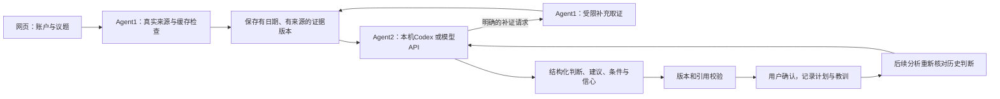

# Stock-Pilot v4.5：业务助手协作与执行机制

## 产品定位

这一版调整正式 Stock-Pilot，不以独立演示页、合成账户或预设分析稿代替业务。
网页上的“更新资料并分析”使用当前账户和真实数据源，调用真实模型；模型结果须确认后才写入分析记忆。

两个角色有意采用不同执行方式：

- **Agent1，数据侧**：确定性采集与缺口维护，负责账户记录、持仓及零数量观察标的、行情、日K、财报、来源日期、存储与展示。它不是伪装成模型的固定回复生成器，也不要求为每次数据更新消耗模型额度。
- **Agent2，分析侧**：真正的模型推理。依据账户、数据侧证据、历史建议和用户议题形成账户/方向/标的三个层级的判断；资料不足时可提出结构化补证请求，再分析新版证据。
- **协调程序**：负责真实任务、来源进度、调用预算、取消、数据指纹、结果校验和人工确认。它不是第三个智能体。

因此，更准确的工程描述是“数据 Agent/工具工作流 + 模型分析 Agent”，不是声称两个自主大模型已经形成经验证的多智能体智能。

## 业务结构与执行映射

| 业务助手 | 页面职责 | 执行模块 | 交接产物 |
| --- | --- | --- | --- |
| 驾驶舱 | 账户、方向、标的三个层级的讨论与计划 | `investment_agents/service.py`协调任务，`providers.py`调用模型 | 任务版本、引用证据的结构化判断、待确认结果及分析记忆 |
| 资料采集 | 正式账户维护、客观取数、时效覆盖与缺口 | `portfolio`、`data_sync`、来源适配器与`investment_agents/data_agent.py` | 账户快照、带日期的来源缓存、引用编号、PDF及覆盖状态 |
| 发现与研究 | 方向筛选、代理核查及个股研究 | `rotation`、既有研究模块及共享资料；分析议题复用驾驶舱入口 | 候选方向、代表标的和可复核的研究事实 |

三者通过同一份正式账户、来源缓存、证据版本和已确认记忆协作，不复制三套账户或在页面间自动启动三个模型。
当前发现与研究不是独立的第三个自主推理进程；旧的独立个股/视觉接口也不会因为切换到研究页就自动变成本机Codex调用。
协调程序是可审计的程序逻辑，不是额外的大模型。

### 交接与权限

1. 数据侧构建账户指纹和证据目录，模型只能引用目录内编号或明确列出的外部来源。
2. 模型通过结构化`request_evidence`请求已有持仓/观察标的的行情、公告或事件资料；协调程序检查范围、次数与重复请求。
3. 补证成功或失败都保留记录；新证据形成新版上下文，再交回分析侧，不将旧版建议静默套到新版账户。
4. 最终结果须校验Schema、引用、当前账户和记忆版本，再进入待确认状态。用户确认只记录判断与计划，不执行交易。
5. 后续分析带入最近三轮已确认结果及最近五批已确认交易，用于延续、修订或撤销历史判断；尚未构成完整收益归因系统。

### 四类状态不能混用

| 状态 | 数据或接口 | 表达什么 | 不表达什么 |
| --- | --- | --- | --- |
| 助手健康灯 | `GET /api/investment-agents/assistant-status` | 数据、来源和模型入口的工作就绪程度 | 股票涨跌、账户是否安全、模型一定可用 |
| 任务执行状态 | `run.status`、事件、心跳、调用/补证计数 | 排队、采集、分析、补证、待确认、失败或停止 | 自动计算的投资风险等级 |
| 数据覆盖 | `coverage.narrow`、`coverage.broad` | 重点资料时效与全市场统计完整度，分开计算 | 模型观点正确率 |
| 观点信心 | 结构化结果的`confidence`及原因 | 模型对某条条件判断的信心与限制 | 获利概率或承诺收益 |

资料采集灯依据狭义覆盖；广义续传或广度统计正在后台运行时，不把已就绪的狭义灯重新降为黄色。
驾驶舱与发现研究仍可因依赖来源、旧账户结果或模型入口显示黄/红灯，因此三个灯不必同步变色。
启动采集与每30分钟Windows任务共用锁和缓存，只取客观数据；模型分析仍需要网页的同意发送和主动触发。

## 使用路径

界面以“驾驶舱、资料采集、发现与研究”三个业务助手组织，不在工作台突出内部 Agent1/Agent2 编号。
每个页签旁的状态灯表示工作就绪程度：绿色可用，黄色为运行中/待更新/部分资料缺失，红色为必要数据不可用、模型入口不可用或最近分析失败。悬停或键盘聚焦可查看原因。
状态检查为只读接口，不运行采集或模型；按来源缓存时限、日K实际观测日期及模型入口检测，不能证明模型额度仍可用或消息已全面覆盖。
资料来源、年报覆盖和缺口集中放在“资料采集”；驾驶舱保留结论、账户建议、行业方向和标的计划，引用证据仍可展开。
资料采集的绿灯改为依据“狭义广度”：已上市持仓日K均有效、关注池有效覆盖至少80%，盘中报价不过期，以及境内大盘/纳指/美元/黄金/有色参考组各至少一个有效来源。各组采用不同市场观测时效，ETF/期货均明确为代理。
“广义广度”单列全市场覆盖数量、比例和日期，不再拖低狭义健康灯。财报等来源缺口继续显示，不把健康灯当作所有资料齐全。驾驶舱与发现研究继续检查模型入口和分析时效，不随资料灯直接变绿。
页签旁眼睛按钮仅遮蔽顶部四项账户基础数据（总盈亏、仓位、现金比例、最大方向暴露），不折叠分析正文、不隐藏其他账户页面。该选项跨页和刷新保留，只是展示开关，不是访问控制或完整脱敏模式。



1. 启动正常应用：`scripts/start_app.ps1`，默认网页 5173、API 8000，以脚本实际输出为准。
2. 在“投资工作台”维护或检查账户，填写本次议题。
3. 选择模型，允许本次资料发送并设置单次最多模型调用次数。
4. 点击“更新资料并分析”。来源按 TTL 更新，失败来源保留具体说明；不会把“任务完成”等同于“资料全部最新”。
5. 页面展示实际阶段、已用时间、心跳、来源条目数、模型调用次数、补证次数和累计 Token，不编造完成百分比。
6. 阅读账户修正建议、行业方向及重点标的计划；默认先展示三个标的，其他展开。
7. 展开依据、信心、反证和原始证据，确认后记录。未确认时可放弃，不能直接覆盖上一份待确认分析。

打开或刷新页面只读状态，不触发模型。数据侧周期任务照常独立运行；本版不默认开启定时模型分析，避免未经授权持续使用额度。

## 模型接入

### 本机 Codex，默认路径

要求安装 Codex CLI，并执行过正式的 `codex login`。
优先检测 PATH；Windows 同时检测当前用户桌面版的 `Programs/Codex/resources/codex.exe`，避免普通 PowerShell 启动后误报未安装。
后端调用 `codex exec`，复用 CLI 官方登录，不读取、复制或代理账户令牌，不需要平台填写 OpenAI API Key。
使用 ChatGPT 登录时仍受相应账号权限和额度约束；不意味着无限使用，也不等于购买了 OpenAI API 服务。

运行限制：

- 只读沙箱；关闭 shell、统一命令执行、子 Agent、Apps、插件、Hooks、浏览器和电脑控制。
- 模型只通过 JSON 请求白名单补证，不直接调用账户写入和交易接口。
- 忽略个人 Codex 配置，防止继承其他模型提供商、工作区插件或高权限设置；不覆盖个人配置。
- 默认可用公开网页检索，可在运行设置关闭；搜索不得包含个人账户金额、持仓股数或交易细节。
- 每轮最多300秒；进程失败、输出过大、截断或版本不符都显式失败，不回填样本或旧结论。
- 输出 Schema 约束后仍经过服务端业务校验；格式通过不代表金融判断正确。
- 单任务1至4次模型调用，默认3次；补证最多4项，同一工具/标的请求不重复执行。最后一轮要求形成有限结论，不继续无限补证。

官方机制参考：[非交互运行](https://learn.chatgpt.com/docs/non-interactive-mode)、[登录方式](https://learn.chatgpt.com/docs/auth)。

### API 适配器

保留兼容模型接口，使用后端既有 `LLM_BASE_URL / LLM_API_KEY / LLM_MODEL`，但默认禁用。
“已配置”不代表订阅仍有效。必须在运行设置显式启用，并主动选择 API 才会调用；本轮未测试已到期的火山引擎。
密钥不通过前端设置或状态接口返回。API 最长180秒、无隐式 SDK 重试，输出未完整结束即拒绝。
此基础适配器不声明支持任意供应商的联网搜索工具；无联网能力时应保留相应消息缺口。

### 人工外部讨论

原 `external_discussion/current` 协议保留，收于“外部手动讨论与既有记录”。
程序化分析不会覆盖正在进行的人工讨论或 `response.json`。
已确认的旧讨论记录作为带日期的历史记忆输入，不自动当成当前市场事实。

## 数据侧的真实覆盖与限制

- 账户来源为本地已记录持仓，不是券商实时自动同步；数量为零的条目作为观察池保留。
- 优先更新持仓/观察标的日K，而非在用户等待时强制全市场下载；日K与实时行情分开记录时间和单位。
- 提供 OHLC、成交量/额、均线、收益、均量、相对前五个完整交易日量能等已有客观字段。
- 财报索引搜索450天、限定分页，优先年报、近期季报/半年报和近期公告；年报缺失时补查年报分类索引。
- 排除“年度报告说明会”等非报告正文，明确区分索引候选与已经取得正文。
- 财务选段优先主要财务数据、合并现金流量表、利润表和管理层讨论，保留页码。全文 PDF 与选段分别保存。
- 不超过现有30MB单文件上限；大文件失败不阻止其他财报采集。扫描 PDF 无文本时明确缺失，不自动发送给旧视觉模型。
- PDF 索引和正文有限，不能据此声称年报或所有章节完整覆盖；分页完整性不作未经证实的承诺。
- 官方宏观源是有限发布线索；商品报价是有时间/延迟边界的参考。不是全网新闻、全球全部市场或未来日历全覆盖。
- 本地广度只代表已覆盖股票样本；不可当成交易所官方两市总额和涨跌家数。
- 输入按80,000字符上限精简展示元数据和财报选段。完整数据仍在本地来源缓存/PDF；省略的段落不是不存在。

数据存储沿用 `backend/data/data_sync`、行情原目录与账户原目录；程序化任务另存于
`backend/data/investment_agents/runs/<run_id>`，每版上下文、提示词、原始模型输出和过程日志可追溯。

## 建议与复核的内容契约

Agent2 的结果包含：

- 账户状态与整体立场，不把仓位大、回撤大直接等同于实质风险。
- 账户、行业方向和具体标的的行动语义：维持、考虑增持/减持、等待、观察或不参与。
- 每项的结论、判断依据、信心与原因、触发条件、反证条件、时间尺度和证据编号。
- 未解决事项、历史判断修订和教训。
- 外部来源若有则附可追溯链接与引文；单独标为模型引用，未冒充本地已核验。

至少包含账户判断；有持仓时还须有具体标的计划。未知引用、旧版本、越权标的或结果未完整结束不能进入预览。
确认后写入分析记忆，下轮带入最近三轮计划与教训，并附最近五批已确认交易记录，区分快照变化与真实成交。
这是持续复核所需的记忆输入，不等于已经实现完整的收益归因、长期策略回测或自动验证模型正确率。

## 自动账户入账与撤销

根据用户授权，提供**完整结构化账户 JSON**的校验后自动入账，不改变交易成交台账，也不发订单。
截图仍走既有草稿入口；未完成可靠识别、缺日期或缺行时不能自动记账，本轮没有宣称旧视觉服务已恢复。

JSON 示例（仅说明字段，不是真实账户；新标的必须明确名称与资产类型）：

```json
{
  "source_id": "broker-export-20261028-1",
  "observed_at": "2026-10-28T15:05:00+08:00",
  "complete": true,
  "cash_available": 10000,
  "total_market_value": 3000,
  "total_assets": 13000,
  "positions": [{
    "symbol": "600036", "name": "招商银行", "asset_type": "stock",
    "quantity": 100, "available_quantity": 100, "avg_cost": -2,
    "broker_screenshot_price": 30, "broker_screenshot_market_value": 3000
  }]
}
```

网页补入当前账户指纹。接口直接使用还需提供 `expected_fingerprint`。
资料须24小时内、带时区、不早于当前快照；逐行数量×价格、市值总和、现金/逆回购与总资产须相符。
负成本合法。完整空仓快照也支持；原有未出现在快照中的观察标的保留。
失败时保留原账户，不自行猜测缺失现金、费用或漏掉的持仓。

来源编号和内容校验实现重复导入幂等；保存前镜像、差异、来源、自动操作身份和记录时间。
不把程序自动校验冒充用户逐行确认；不刷新原本金确认来源。
撤销仅当当前账户仍与该次写入结果相同才允许，防止覆盖后来的人工修改；撤销仍保留审计。
如记录停留在 prepared，表示写入中断，应检查当前指纹；不能把它直接当作已成功入账。

## 安全与旧流程

真实账户与本机模型接口只允许本机客户端、Host和Origin，拒绝远程访问及DNS重绑定。
这是个人本机工作流，不是可直接公开部署的多租户服务；面试展示应本机演示或另做脱敏录屏，不能暴露真实账户接口。
所有新任务、PDF缓存和模型输出位于已忽略Git的私有目录。

正式后端默认启动独立的无模型采集，先重点资料再全市场分批续传；已有Windows每30分钟任务继续同一流程。`STOCK_PILOT_AUTO_DATA_SYNC=0`可单独关闭启动采集。
旧的采集与模型巡检混合循环仍默认关闭，不以恢复全市场更新为由重新启用旧模型。
只有显式设置 `STOCK_PILOT_ENABLE_LEGACY_AUTOMATION=1` 才启用旧启动任务，不建议在新流程下混用。
历史个股分析、旧视觉入口等兼容功能未全部替换为Codex；不要据此宣称所有旧LLM功能已经迁移或重新验证。

## 验证与演示

```powershell
Set-Location C:\Project\Stock-Pilot\backend
C:\Python312\python.exe -m pytest tests/test_investment_agents.py tests/test_headless_data_sync.py tests/test_external_discussion.py tests/test_task_runtime.py tests/test_agent_collaboration_demo.py -q

Set-Location C:\Project\Stock-Pilot\frontend
npm run build

Set-Location C:\Project\Stock-Pilot
node scripts/smoke_investment_agents.cjs
```

浏览器脚本默认 mock 写入与模型，验证同意发送、统一触发、证据展开、确认、设置编辑和桌面/手机排版。
`REAL_READONLY=1` 额外读取实际已完成分析进行展示验收，但不触发推理、确认或修改持仓。

开发验收进行过一次经授权的真实Codex分析，返回可校验的账户/方向/标的判断并停在用户确认前。
同时暴露了财报选段和说明会误归类问题，已修正数据层并做无模型验证；没有为了验证这些修正再次消耗模型额度。
单次成功不构成模型投资能力、新闻覆盖、建议有效性或长期稳定性的评测结论。

面试建议直接展示正常工作台：真实来源与时间 → 模型运行记录 → 一条具体计划及证据 → 人工确认 → 下一轮读取历史计划。
演示实际业务能力和当前限制，不以场景脚本替代真实推理。
